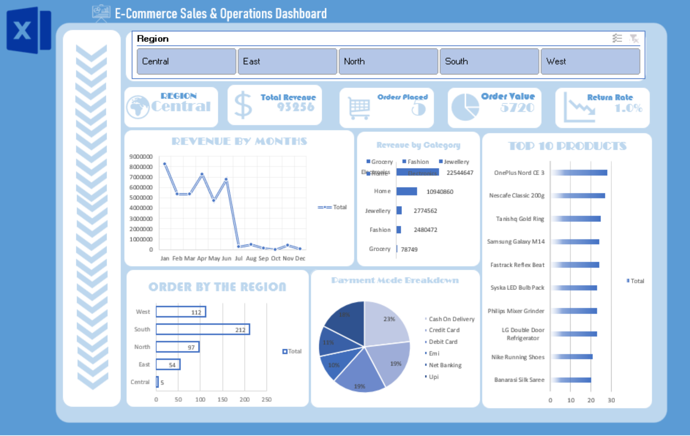

ecommerce-sales-operations-excel-dashboard

An interactive E-Commerce Sales & Operations Dashboard built in Microsoft Excel. This project started with raw data, which I cleaned and prepared before creating KPIs, PivotTables, PivotCharts, and an interactive dashboard.

Dashboard Preview

Project Overview
The dashboard provides a visual overview of e-commerce sales and operations metrics. A region slicer allows users to filter the dashboard by Central, East, North, South, and West.

Dashboard Features
- KPI cards: Total Revenue, Orders Placed, Order Value, and Return Rate
- Revenue by Month: Monthly revenue trends
- Revenue by Category: Category-level revenue comparison
- Top 10 Products: Products ranked by total orders
- Orders by Region: Order count comparison across regions
- Payment Mode Breakdown: Payment-method distribution
- Region Slicer: Interactive filtering across regions

Skills Practiced
- Data cleaning and preparation
- Excel Tables and date/number formatting
- PivotTables and PivotCharts
- KPI creation
- Interactive slicers
- Dashboard layout and data visualization

Key Learning
One of my key takeaways from this project is that data cleaning is a crucial and often challenging part of data analysis. Preparing accurate, structured data is an important foundation for creating meaningful analysis and dashboards.

Tools
- Microsoft Excel

Credits
Learning guidance and inspiration: Adda247 Skills Telugu.

This dashboard was created as part of my learning journey in Excel and data analytics.
